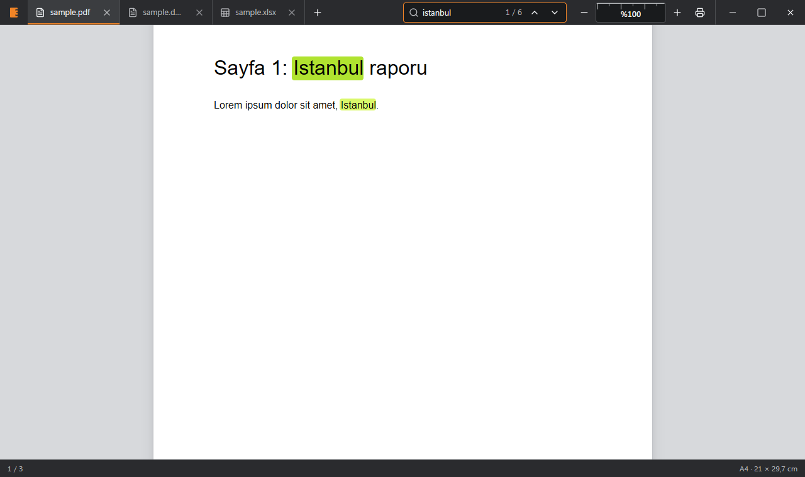
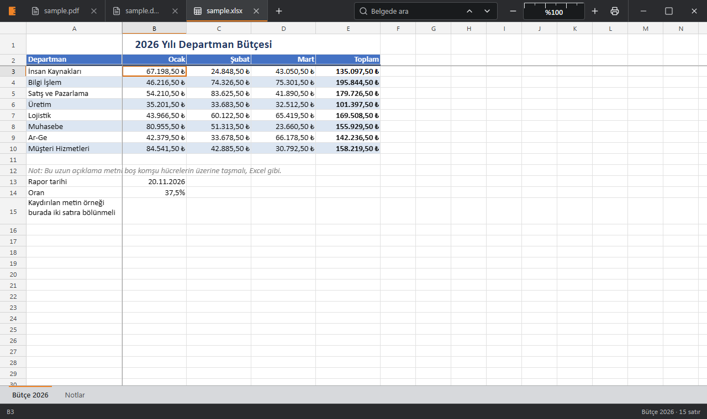
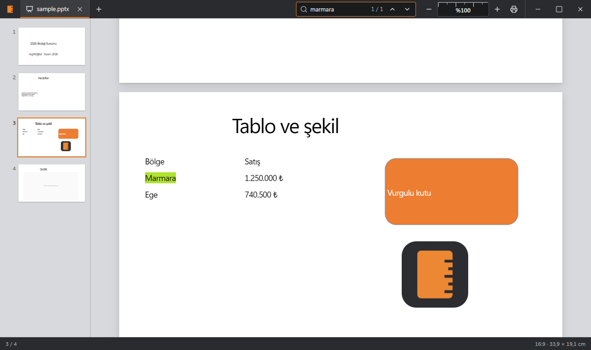
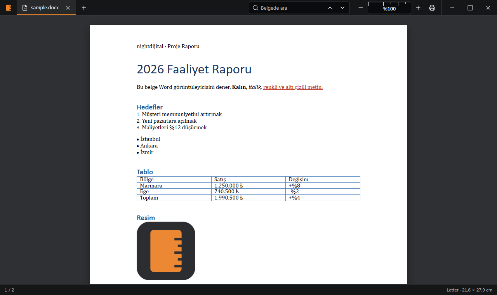
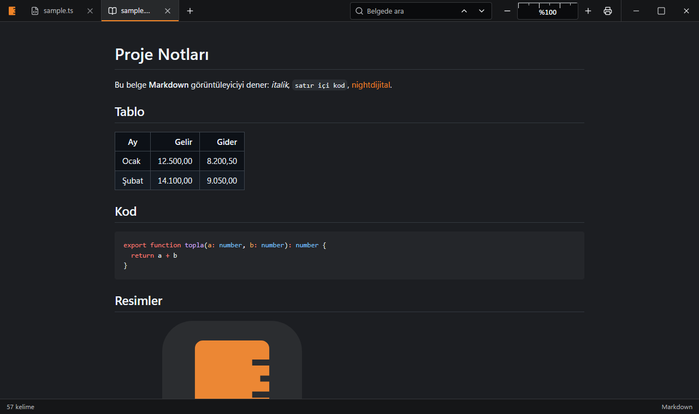

<p align="center">
  
</p>

<h1 align="center">Document Viewer</h1>

<p align="center">
  One window for every document on your PC: PDF, Word, Excel, PowerPoint, Markdown, text and code, in tabs. It needs no Office, LibreOffice or any other program, and it never goes online.
</p>

<p align="center">
  <a href="https://github.com/nightdevx/document-viewer/releases/latest"></a>
  
  
  <a href="LICENSE"></a>
</p>

<p align="center">
  <b>English</b> · <a href="README.tr.md">Türkçe</a>
</p>

<p align="center">
  
</p>
<p align="center">
  
  
</p>
<p align="center">
  
  
</p>

## Features

- **PDF:** fast even with hundreds of pages, selectable text, search, password-protected files, printing at page size. The status bar shows the page and its paper size (A4 · 21 × 29,7 cm).
- **Word (.docx):** pages laid out like Word, with headers and footers, lists, tables, images and columns.
- **Excel (.xlsx, .xls, .csv):** a real grid with frozen panes, merged cells, fonts, fills and borders, number, currency and date formats in your locale (1.234,50 in Turkish), images and sheet tabs. A 100,000-row sheet opens in a few seconds and scrolls smoothly. CSV files keep their text exactly as written.
- **PowerPoint (.pptx):** slides with a thumbnail strip; click a thumbnail or use Page Up and Page Down.
- **Markdown, text and code:** GitHub-style Markdown, syntax colours for common languages, line numbers. Old Turkish text files (Windows-1254) open with the right letters.
- **Tabs:** files you double-click while the app is open join it as new tabs; opening the same file again just switches to it. Drag files onto the window to open them.
- **Search, zoom, print** in every format. Ctrl + mouse wheel zooms around the cursor; the zoom control is a ruler whose ticks are real centimetres.
- **Light or dark** with Windows. Pages stay white, like paper on a desk.

Not yet: charts, SmartArt and EMF/WMF pictures show a placeholder; .doc and .ppt (the old binary formats) are not supported; PowerPoint table styles are drawn plain.

## Install

Download `DocumentViewer-Setup-<version>.exe` from [Releases](https://github.com/nightdevx/document-viewer/releases/latest) and run it. No administrator rights are needed; it installs for your user only, and you can pick the folder.

The installer isn't code-signed yet, so Windows SmartScreen may warn you: choose **More info → Run anyway**.

Windows lets only you choose the default app for a file type. After installing, right-click a PDF → **Open with → Choose another app → Document Viewer → Always**, and do the same for .docx, .xlsx, .pptx, .md and .txt. Or click **Set as default app** on the app's start screen to open Windows' Default apps page.

Requires Windows 10 or 11, 64-bit. The interface is in Turkish.

## Use

| | |
|---|---|
| Ctrl + O | Open files |
| Ctrl + W / middle click | Close the tab |
| Ctrl + Tab, Ctrl + Shift + Tab | Next / previous tab |
| Ctrl + F, Enter, Shift + Enter, Esc | Search, next match, previous match, clear |
| Ctrl + mouse wheel, Ctrl + + / − | Zoom (around the cursor with the wheel) |
| Ctrl + 0 or click the ruler | Back to 100 % (real size) |
| Ctrl + P | Print |

## Privacy and safety

Documents are opened as untrusted: nothing in a file can run code, reach the network or read other files. Pictures and fonts a document points to on the internet are blocked and shown as a placeholder; links open in your browser only when they are web or mail links. The app itself makes no network requests and keeps no history.

## Uninstall

Settings → Apps → Installed apps → Document Viewer → Uninstall.

## Build from source

You need Node.js 22 or newer.

```powershell
npm install
npm run dev         # run with hot reload
npm test            # unit tests (Vitest)
npm run build:win   # installer in %LOCALAPPDATA%\document-viewer-build
```

Releases are built on GitHub: pushing a version tag (`git tag -a v1.2.3 -F notes.md`, then `git push origin v1.2.3`) runs `.github/workflows/release.yml`, which tests, builds the installer and publishes it with the tag's message as the notes.

How it is put together:

| | |
|---|---|
| `src/main/` | Window, single instance, file reading, the `app://` protocol the UI loads from |
| `src/preload/` | The small API the UI may call |
| `src/renderer/src/shell/` | Tabs, search, zoom, status bar, printing |
| `src/renderer/src/viewers/` | One viewer per format: `pdf.ts` (pdf.js), `docx.ts` (docx-preview), `sheet/` (exceljs and SheetJS in a worker, own grid), `pptx.ts` (pptx-preview), `markdown.ts`, `code.ts` (shiki) |
| `design/logo/` | The logo and app icons |

## Contact

nightdijital · [nightdijital.com](https://nightdijital.com) · [iletisim@nightdijital.com](mailto:iletisim@nightdijital.com)

Released under the [MIT license](LICENSE).
