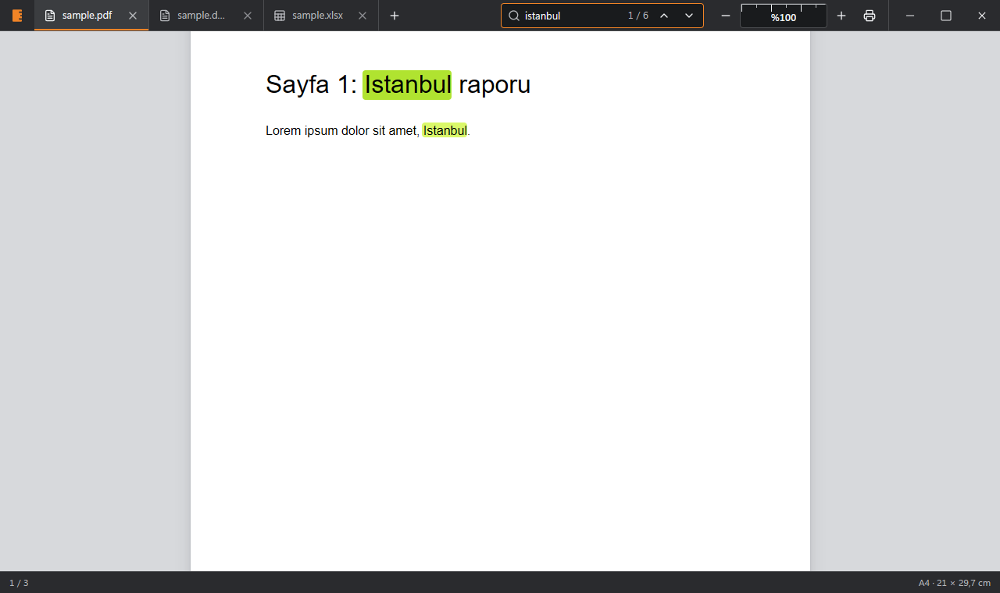
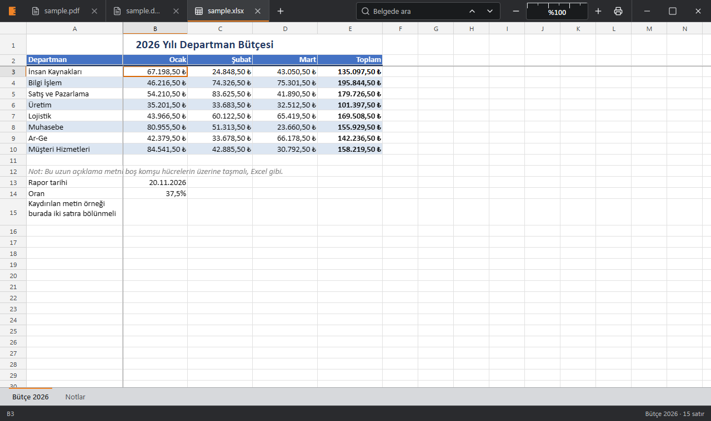
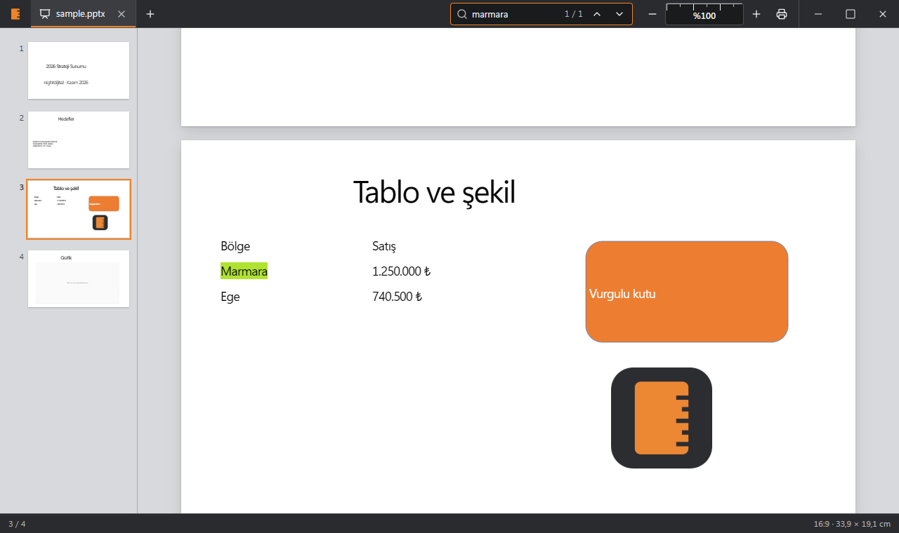
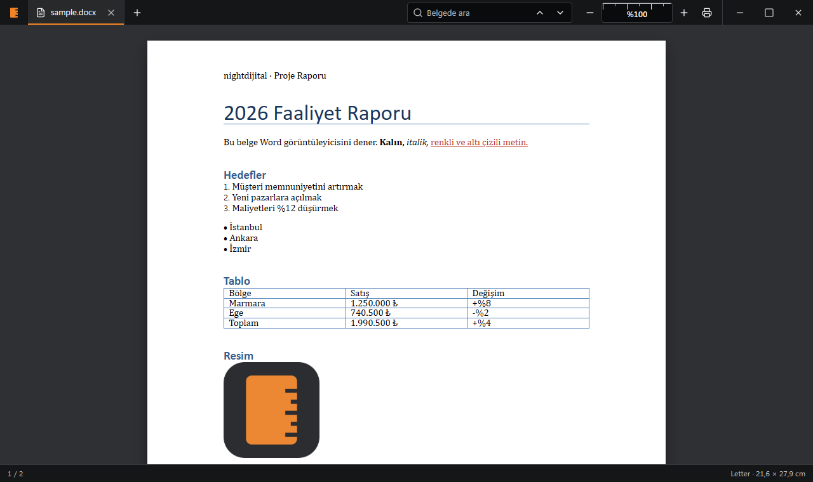
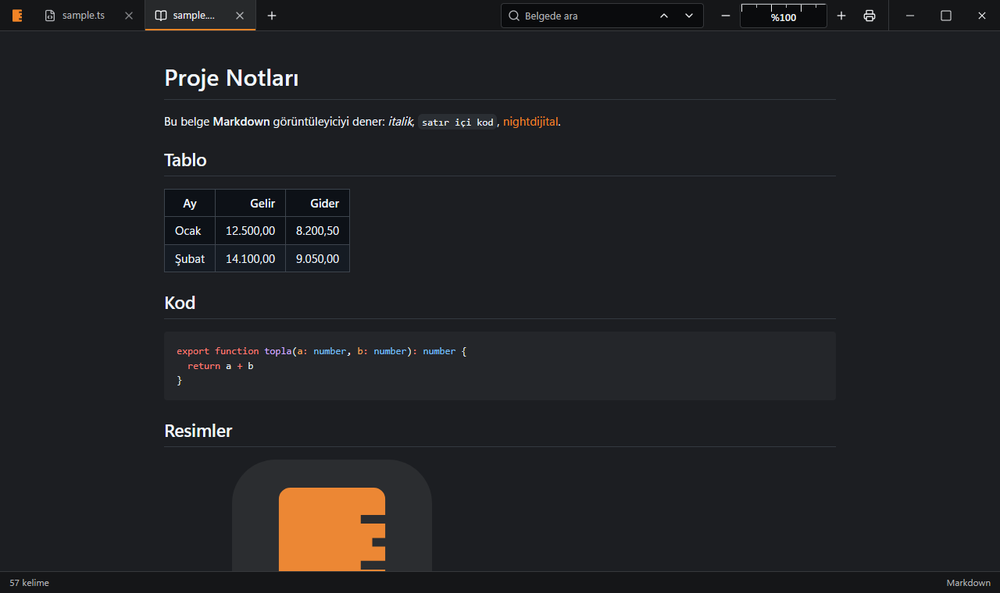

<p align="center">
  
</p>

<h1 align="center">Document Viewer</h1>

<p align="center">
  Bilgisayarındaki her belge için tek pencere: PDF, Word, Excel, PowerPoint, Markdown, metin ve kod, sekmeler halinde. Office, LibreOffice ya da başka bir program gerekmez, internete hiç çıkmaz.
</p>

<p align="center">
  <a href="https://github.com/nightdevx/document-viewer/releases/latest"></a>
  
  
  <a href="LICENSE"></a>
</p>

<p align="center">
  <a href="README.md">English</a> · <b>Türkçe</b>
</p>

<p align="center">
  
</p>
<p align="center">
  
  
</p>
<p align="center">
  
  
</p>

## Özellikler

- **PDF:** Yüzlerce sayfada bile hızlı. Seçilebilir metin, arama, şifreli dosyalar ve sayfa boyutunda yazdırma var. Durum çubuğu sayfayı ve kâğıt boyutunu gösterir (A4 · 21 × 29,7 cm).
- **Word (.docx):** Sayfalar Word'deki gibi dizilir. Üst ve alt bilgi, listeler, tablolar, resimler ve sütunlar görünür.
- **Excel (.xlsx, .xls, .csv):**
  - Gerçek bir ızgara: sabit bölmeler, birleşik hücreler, yazı tipleri, dolgular ve kenarlıklar.
  - Sayı, para ve tarih biçimleri senin dilinde gösterilir (1.234,50).
  - Resimler ve sayfa sekmeleri de görünür.
  - 100.000 satırlık bir sayfa birkaç saniyede açılır ve akıcı kayar.
  - CSV dosyalarındaki metin yazıldığı gibi kalır.
- **PowerPoint (.pptx):** Slaytlar ve solda küçük resim şeridi. Küçük resme tıkla ya da Page Up / Page Down kullan.
- **Markdown, metin ve kod:** GitHub tarzı Markdown, yaygın diller için renklendirme ve satır numarası. Eski Türkçe metin dosyaları (Windows-1254) doğru harflerle açılır.
- **Sekmeler:**
  - Uygulama açıkken çift tıkladığın dosya yeni sekme olur.
  - Aynı dosyayı tekrar açarsan zaten açık olan sekmesine geçer.
  - Dosyaları pencereye sürükleyerek de açabilirsin.
- **Arama, yakınlaştırma ve yazdırma** her formatta var. Ctrl + fare tekerleği imlecin olduğu yeri yakınlaştırır. Yakınlaştırma göstergesi, çentikleri gerçek santimetre olan bir cetvel.
- **Açık ya da koyu tema** Windows'u izler. Sayfalar masadaki kâğıt gibi beyaz kalır.

Henüz yok: Grafik, SmartArt ve EMF/WMF resimlerin yerinde yer tutucu görünür. .doc ve .ppt (eski ikili formatlar) desteklenmez. PowerPoint tablo stilleri düz çizilir.

## Kurulum

[Releases](https://github.com/nightdevx/document-viewer/releases/latest) sayfasından `DocumentViewer-Setup-<sürüm>.exe` dosyasını indirip çalıştır. Yönetici izni gerekmez, sadece senin kullanıcın için kurulur. Kurulum klasörünü sen seçebilirsin.

Kurulum programı henüz imzalı değil. Windows SmartScreen uyarırsa **Ek bilgi → Yine de çalıştır** de.

Bir dosya türünün varsayılan uygulamasını Windows sadece senin seçmene izin verir. Kurduktan sonra:
- Bir PDF'e sağ tıkla → **Birlikte aç → Başka bir uygulama seç → Document Viewer → Her zaman**.
- Aynısını .docx, .xlsx, .pptx, .md ve .txt için de yap.

Ya da uygulamanın açılış ekranındaki **Varsayılan uygulama olarak ayarla** bağlantısıyla Windows'un Varsayılan uygulamalar sayfasını aç.

Windows 10 ya da 11, 64 bit gerekir. Arayüz Türkçe.

## Kullanım

| | |
|---|---|
| Ctrl + O | Dosya aç |
| Ctrl + W / orta tık | Sekmeyi kapat |
| Ctrl + Tab, Ctrl + Shift + Tab | Sonraki / önceki sekme |
| Ctrl + F, Enter, Shift + Enter, Esc | Ara, sonraki, önceki, temizle |
| Ctrl + fare tekerleği, Ctrl + + / − | Yakınlaştır (tekerlekle imlecin olduğu yeri) |
| Ctrl + 0 ya da cetvele tıkla | %100'e (gerçek boyut) dön |
| Ctrl + P | Yazdır |

## Gizlilik ve güvenlik

Belgeler güvenilmez kabul edilerek açılır:
- Dosyanın içindeki hiçbir şey kod çalıştıramaz, internete çıkamaz ya da başka dosyaları okuyamaz.
- Belgenin internetten çektiği resim ve yazı tipleri engellenir, yerinde yer tutucu görünür.
- Bağlantılar sadece web ya da e-posta bağlantısıysa tarayıcında açılır.

Uygulamanın kendisi hiçbir ağ isteği yapmaz, geçmiş de tutmaz.

## Kaldırma

Ayarlar → Uygulamalar → Yüklü uygulamalar → Document Viewer → Kaldır.

## Kaynaktan derleme

Node.js 22 ya da daha yenisi gerekir.

```powershell
npm install
npm run dev         # anlık yenilemeyle çalıştır
npm test            # birim testleri (Vitest)
npm run build:win   # kurulum programı %LOCALAPPDATA%\document-viewer-build içine
```

Sürümler GitHub'da derlenir:
- Bir sürüm etiketi itmek yeter: `git tag -a v1.2.3 -F notes.md`, ardından `git push origin v1.2.3`.
- Bu, `.github/workflows/release.yml` iş akışını çalıştırır.
- İş akışı testleri koşar, kurulum programını derler ve etiket mesajını sürüm notu olarak kullanıp yayınlar.

## İletişim

nightdijital · [nightdijital.com](https://nightdijital.com) · [iletisim@nightdijital.com](mailto:iletisim@nightdijital.com)

[MIT lisansı](LICENSE) ile yayınlanır.
